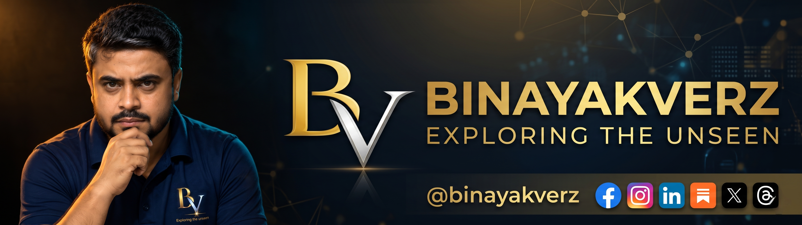

<!-- Image 1. Banner (UNCHANGED) -->

 
 

<!-- Real-time Terminal Typing Animation (Full Width - No Cutoff) -->

 

<!-- 3D Metallic Quick-Access Gateway Plates -->

  
  
  
  

<!-- 3D Fluid Gradient Divider -->

<!-- ================= REAL GRADIENT ABOUT SECTIONS ================= -->

<table width="100%">
  <tr>
    <td width="100%" valign="top">
      
        
      <h4>🌌 Exploring the Unseen. Questioning What Everyone Accepts.</h4>
      
The world is full of questions we rarely ask, assumptions we rarely challenge, and realities we have yet to understand.

      
<b>BINAYAKVERZ</b> is an independent research platform and intellectual publication dedicated to exploring the ideas, discoveries, and unanswered questions that shape our understanding of the world.

      
From artificial intelligence and human behaviour to science, society, philosophy, and the mysteries of existence, this is a space for analytical inquiry that looks beyond the obvious.

      
<i>We don’t just ask what is happening. We ask why it matters, what the evidence reveals, and what we might be missing.</i>

       
      
    </td>
  </tr>
</table>

 

<table width="100%">
  <tr>
    <td width="100%" valign="top">
      
        
      
<b>Binayak Bhal Chandra</b> is an independent AI researcher, educator, and author whose inquiries span artificial intelligence, science, human behaviour, education, society, and the future of humanity.

      
He is the Founder and CEO of <b>Binayak Bhaiya – Education and Research Center</b>, an educational initiative established in 2013 in Dharhara, Munger, Bihar, India[cite: 28].

      
His approach is guided by three core principles[cite: 28]:

      

        
        
        
      

      
The objective is not to offer easy answers to every difficult question, but to investigate those questions honestly, distinguish established empirical findings from speculation, and encourage independent thought[cite: 28].

       
      
    </td>
  </tr>
</table>

 

<!-- ================= FULL GRADIENT WHAT WE EXPLORE BOXES ================= -->

  

 

<table width="100%">
  <tr>
    <td width="50%" valign="top">
      
      <h4>🤖 Artificial Intelligence & Technology</h4>
      
Artificial intelligence is changing how we think, work, learn, create, and make decisions. We explore its capabilities, limitations, ethical challenges, social consequences, and implications for the future of humanity.

      
    </td>
    <td width="50%" valign="top">
      
      <h4>🧠 Human Behaviour & Psychology</h4>
      
Why do we think the way we do? How do our beliefs, habits, emotions, biases, and environments influence our decisions? These explorations examine the hidden mechanisms behind everyday human behaviour.

      
    </td>
  </tr>
  <tr>
    <td width="50%" valign="top">
      
      <h4>🔭 Science, Space & The Universe</h4>
      
From scientific discoveries and the mysteries of the cosmos to the origins of life and the possibility of life beyond Earth, we investigate questions that expand our understanding of reality.

      
    </td>
    <td width="50%" valign="top">
      
      <h4>📚 Society, Education & Employment</h4>
      
We examine education systems, the relationship between degrees and skills, changing employment opportunities, social inequality, and the challenges facing young people in a rapidly transforming world.

      
    </td>
  </tr>
  <tr>
    <td width="50%" valign="top">
      
      <h4>🌌 Philosophy, Reality & Existence</h4>
      
What does it mean to understand reality? How should we approach questions about consciousness, existence, knowledge, and the limits of human understanding? These explorations bring philosophical inquiry into conversation with science and reason.

      
    </td>
    <td width="50%" valign="top">
      
      <h4>🌍 Nature, Earth & The Future</h4>
      
Explore the natural world, climate, oceans, ecosystems, technological change, and the forces shaping the future of our planet and civilisation.

      
    </td>
  </tr>
</table>

---

<!-- ================= PODCAST & BOOK ================= -->
<table width="100%">
  <tr>
    <td width="50%" align="center" valign="top">
      
      <h4>🎙️ Beyond Algorithms — Truth Beyond Trends</h4>
      
The flagship podcast within the BINAYAKVERZ research ecosystem. Through discussions, the podcast explores the human side of artificial intelligence, technology, society, psychology, and questions beyond headlines and popular narratives.

      
<b>BINAYAKVERZ is the exploration. Beyond Algorithms is the conversation.</b>

       
      
        
      
    </td>
    <td width="50%" align="center" valign="top">
      
      <h4>📖 Jaguar Vision — Exploring the Mind of AI</h4>
      
A research-driven book project exploring artificial intelligence beyond computational mechanics, investigating synthetic cognition, human consciousness, and the future horizons of thinking machines.

      
<b>Distinguishing established findings from speculation.</b>

       
      
        
      
    </td>
  </tr>
</table>

---

### 🔬 Research & Academic Profiles
Explore Binayak Bhal Chandra’s academic identity, research contributions, and scholarly work through the following profiles:

| Profile / Registry | Direct Access Link | Node ID |
| :--- | :--- | :--- |
| 🪪 **ORCID** | [https://orcid.org/0009-0005-7901-0926](https://orcid.org/0009-0005-7901-0926) | `0009-0005-7901-0926` |
| 🌐 **Web of Science** | [ResearcherID Profile](https://www.webofscience.com/wos/author/record/RFB-8357-2026) | `RFB-8357-2026` |
| 🎓 **Google Scholar** | [Scholarly Citations](https://scholar.google.com/citations?user=NkFPkh4AAAAJ&hl=en) | `NkFPkh4AAAAJ` |
| 📑 **Zenodo** | [Research & Preprints](https://zenodo.org/records/23103701) | `Record: 23103701` |

---

<!-- ================= TELEMETRY ================= -->

  
    
  

---

<!-- ================= 3D SOCIAL DOCK ================= -->

<h3>⚡ Connect With BINAYAKVERZ</h3>

Follow BINAYAKVERZ for research articles, long-form inquiries, analysis, and official updates across our platforms (Handle: <b>@binayakverz</b>)

  
  
  
  
  
  
  
  

<!-- 3D Sci-Fi Terminal Footer -->

